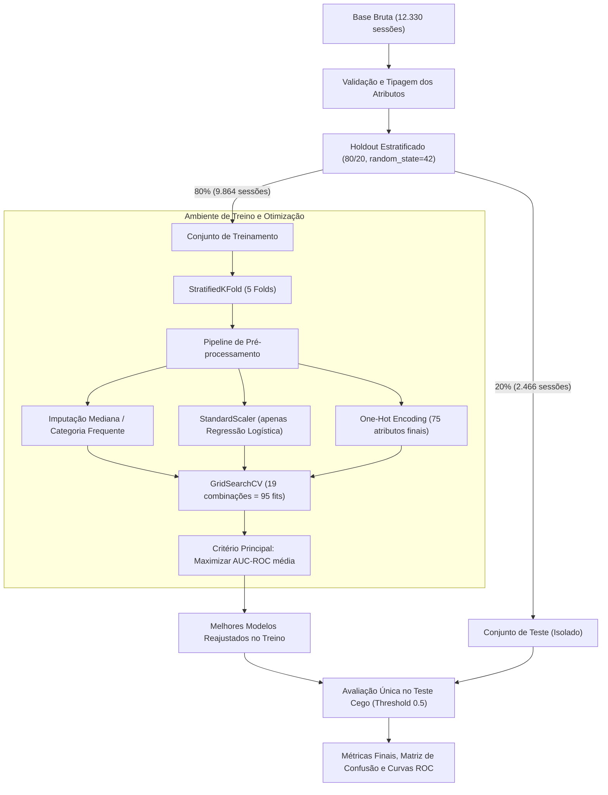
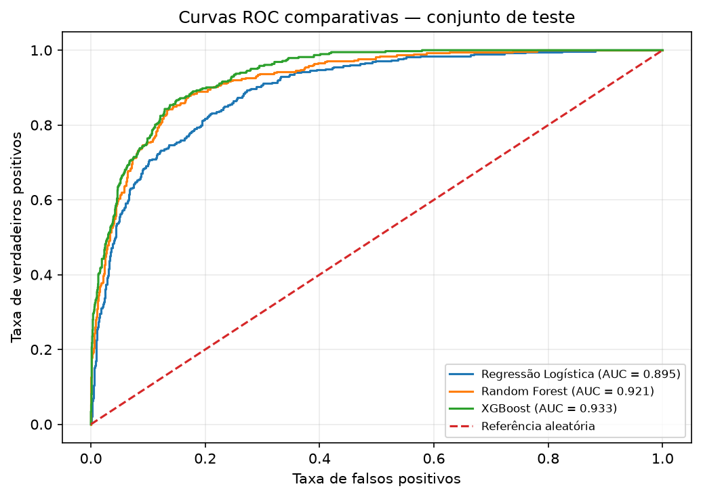
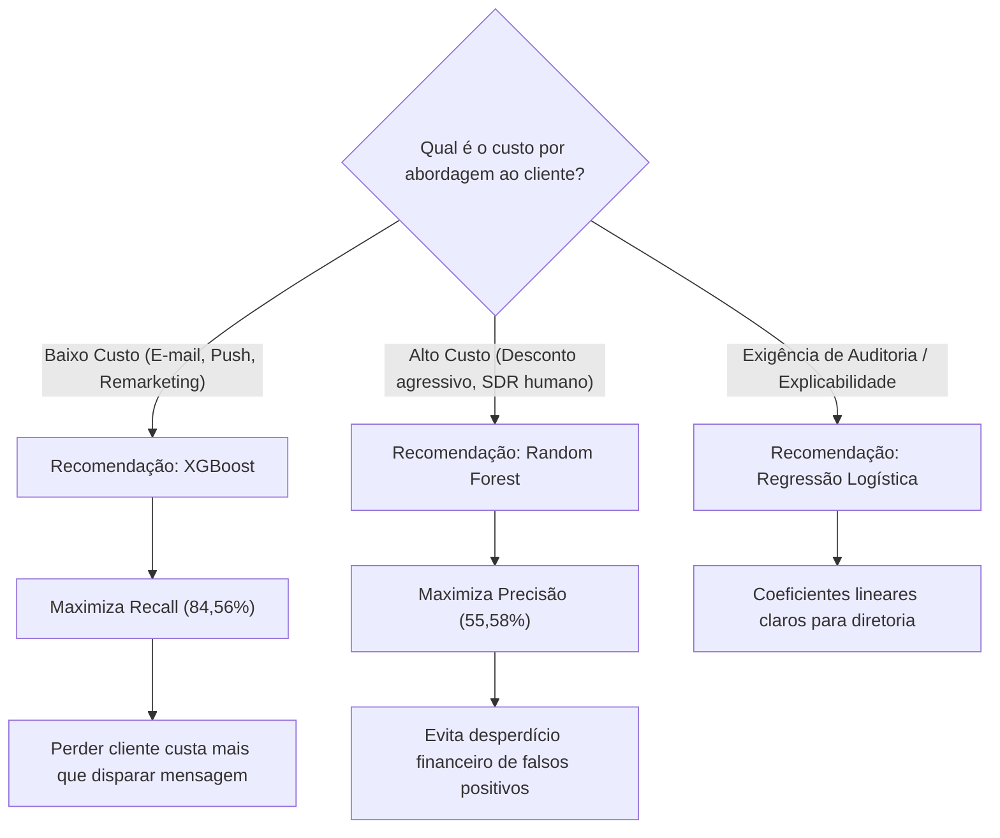

# Comparação de Modelos Preditivos na Estimativa da Propensão de Compra no Varejo

[](https://www.python.org/)
[](https://scikit-learn.org/)
[](https://xgboost.readthedocs.io/)
[](https://pandas.pydata.org/)
[]()
[]()

> **Trabalho de Graduação Interdisciplinar (TGI II / TCC)**  
> **Curso:** Bacharelado em Ciência da Computação  
> **Instituição:** Universidade Cruzeiro do Sul (São Paulo – SP)  
> **Autores:**  
> - Arthur Cardoso de Lima ([2701arthur@gmail.com](mailto:2701arthur@gmail.com))  
> - João V. Ferreira de Paula ([joasescolar@gmail.com](mailto:joasescolar@gmail.com))  
> - Roberto M. Dalpino Alves ([robertomessiasdalpino@gmail.com](mailto:robertomessiasdalpino@gmail.com))  

---

## 📋 Sumário

- [Comparação de Modelos Preditivos na Estimativa da Propensão de Compra no Varejo](#comparação-de-modelos-preditivos-na-estimativa-da-propensão-de-compra-no-varejo)
  - [📋 Sumário](#-sumário)
  - [1. Visão Geral do Projeto](#1-visão-geral-do-projeto)
    - [1.1 Contexto e Justificativa de Negócio](#11-contexto-e-justificativa-de-negócio)
    - [1.2 Questão de Pesquisa e Hipótese](#12-questão-de-pesquisa-e-hipótese)
  - [2. Conjunto de Dados (Dataset)](#2-conjunto-de-dados-dataset)
    - [2.1 Estrutura da Base](#21-estrutura-da-base)
    - [2.2 O Desafio do Desbalanceamento de Classes](#22-o-desafio-do-desbalanceamento-de-classes)
      - [A Armadilha da Acurácia](#a-armadilha-da-acurácia)
    - [2.3 Qualidade dos Dados e Decisões Metodológicas](#23-qualidade-dos-dados-e-decisões-metodológicas)
  - [3. Metodologia e Pipeline](#3-metodologia-e-pipeline)
    - [3.1 Arquitetura do Pipeline](#31-arquitetura-do-pipeline)
    - [3.2 Prevenção de Data Leakage](#32-prevenção-de-data-leakage)
    - [3.3 Estratégia de Balanceamento](#33-estratégia-de-balanceamento)
    - [3.4 Protocolo de Avaliação e Otimização](#34-protocolo-de-avaliação-e-otimização)
  - [4. Modelos Avaliados](#4-modelos-avaliados)
  - [5. Resultados Experimentais e Benchmarking](#5-resultados-experimentais-e-benchmarking)
    - [5.1 Desempenho na Validação Cruzada (5-Fold CV)](#51-desempenho-na-validação-cruzada-5-fold-cv)
    - [5.2 Desempenho Final no Conjunto de Teste (Holdout Cego)](#52-desempenho-final-no-conjunto-de-teste-holdout-cego)
    - [5.3 Curva ROC Comparativa](#53-curva-roc-comparativa)
    - [5.4 Trade-off Operacional e Matrizes de Confusão](#54-trade-off-operacional-e-matrizes-de-confusão)
      - [O Dilema do Varejo: XGBoost vs. Random Forest](#o-dilema-do-varejo-xgboost-vs-random-forest)
    - [5.5 Importância das Variáveis (Feature Importance)](#55-importância-das-variáveis-feature-importance)
  - [6. Guia Prático de Implantação e Recomendação de Negócio](#6-guia-prático-de-implantação-e-recomendação-de-negócio)
  - [7. Limitações Metodológicas](#7-limitações-metodológicas)
  - [8. Estrutura do Repositório](#8-estrutura-do-repositório)
  - [9. Como Executar o Projeto](#9-como-executar-o-projeto)
    - [9.1 Pré-requisitos](#91-pré-requisitos)
    - [9.2 Instalação](#92-instalação)
    - [9.3 Execução do Jupyter Notebook](#93-execução-do-jupyter-notebook)
    - [9.4 Visualização do Relatório Web Interativo](#94-visualização-do-relatório-web-interativo)
  - [10. Referências Bibliográficas](#10-referências-bibliográficas)

---

## 1. Visão Geral do Projeto

Este repositório contém o código-fonte, bases de dados, rotinas de pré-processamento, modelos treinados, saídas analíticas e o relatório interativo desenvolvidos para o **Trabalho de Conclusão de Curso (TCC / TGI II)** em **Ciência da Computação** pela **Universidade Cruzeiro do Sul**.

### 1.1 Contexto e Justificativa de Negócio

Com a projeção de que o volume global de dados digitais ultrapasse 175 zettabytes (IDC, 2018), o comércio eletrônico se consolidou como uma das principais fontes de fluxos massivos de eventos comportamentais em tempo real. No entanto, muitas organizações ainda realizam campanhas de marketing padronizadas e generalistas, resultando em:
- **Desperdício de orçamento** em disparos e cupons para usuários com baixa ou nula probabilidade de conversão.
- **Fadiga do cliente** por saturação de notificações e mensagens irrelevantes.
- **Perda de receita incremental**, ao não agir cirurgicamente sobre visitantes com alta intenção de compra que abandonariam o carrinho sem um estímulo oportuno.

A estimativa preditiva da **propensão de compra** a partir do comportamento de navegação da sessão permite priorizar ações automatizadas - como concessão dinâmica de descontos, remarketing direcionado ou atendimento humano assistido - otimizando o retorno sobre o investimento (ROI) de marketing (Salesforce, 2022).

### 1.2 Questão de Pesquisa e Hipótese

> **Questão de Pesquisa:**  
> *Modelos supervisionados não lineares (Random Forest e XGBoost) superam um modelo linear de referência (Regressão Logística) na capacidade de discriminar compradores de não compradores no e-commerce? Qual algoritmo atinge o equilíbrio ótimo entre capacidade discriminatória, estabilidade de generalização e interpretabilidade para o negócio?*

A hipótese investigada sustenta que o comportamento de compra em lojas virtuais é inerentemente complexo e não linear (interações entre tempo na página, valor de catálogo e sazonalidade), justificando o uso de algoritmos baseados em árvores e boosting em detrimento de abordagens lineares clássicas.

---

## 2. Conjunto de Dados (Dataset)

O estudo utiliza o consolidado [Online Shoppers Purchasing Intention Dataset](https://doi.org/10.24432/C5F88Q) (Sakar & Kastro, 2018), disponibilizado pelo *UCI Machine Learning Repository*.

### 2.1 Estrutura da Base

- **Total de registros:** 12.330 sessões de e-commerce.
- **Variáveis originais:** 18 colunas (17 atributos preditores + 1 variável-alvo).
- **Variável-Alvo (`Revenue`):** Booleana indicando se a sessão culminou em transação financeira (`True` / `1`) ou não (`False` / `0`).
- **Divisão das variáveis de entrada:**
  - **10 Variáveis Numéricas:** `Administrative`, `Administrative_Duration`, `Informational`, `Informational_Duration`, `ProductRelated`, `ProductRelated_Duration`, `BounceRates`, `ExitRates`, `PageValues` e `SpecialDay`.
  - **7 Variáveis Categóricas:** `OperatingSystems`, `Browser`, `Region`, `TrafficType`, `VisitorType`, `Month` e `Weekend`.

> ⚠️ **Atenção conceitual:** As variáveis `OperatingSystems`, `Browser`, `Region` e `TrafficType` vêm codificadas originalmente como inteiros numéricos. Tratá-las como variáveis contínuas geraria ordenação e métricas de distância artificiais; portanto, foram categorizadas estritamente como atributos nominais. Após a expansão por *One-Hot Encoding*, a matriz de entrada resulta em **75 variáveis preditoras**.

### 2.2 O Desafio do Desbalanceamento de Classes

A distribuição da variável `Revenue` reflete o comportamento real do comércio eletrônico:

| Classe | Descrição | Sessões | Proporção (%) |
| :--- | :--- | :---: | :---: |
| **0** | Não Compra (*Negative Class*) | 10.422 | **84,53%** |
| **1** | Compra (*Positive Class*) | 1.908 | **15,47%** |
| **Total** | Amostra Completa | 12.330 | 100,00% |

#### A Armadilha da Acurácia
Em um cenário com 84,53% de sessões sem compra, um classificador ingênuo (*dummy*) que previsse apenas "não compra" para todas as instâncias atingiria **84,53% de acurácia**, mas teria **0% de recall**, sendo inútil para o negócio. Por isso, a avaliação deste projeto prioriza **AUC-ROC**, **F1-Score**, **Recall** e **Precisão**.

### 2.3 Qualidade dos Dados e Decisões Metodológicas

1. **Valores Ausentes e Infinitos:** Nenhum valor nulo ou infinito foi encontrado na base. No entanto, o pipeline foi desenhado preventivamente com imputadores (`SimpleImputer`) para tolerância a falhas em produção.
2. **Duplicidades Exatas:** Foram detectadas **125 linhas integralmente duplicadas (1,01%)**. Como o dataset não possui identificador exclusivo de sessão (ex.: ID ou cookie de sessão), não é possível atestar se tratam-se de requisições duplicadas por erro ou de navegações idênticas independentes. Optou-se pela **manutenção dos registros**, documentando a escolha como limitação metodológica.
3. **Detecção de Outliers (IQR):** Pelo método do Intervalo Interquartil ($Q_1 - 1,5 \times IQR$ e $Q_3 + 1,5 \times IQR$), atributos como `PageValues` (22,1%) e `Informational` (21,3%) exibiram elevada proporção de valores extremos. Como tais valores decorrem da forte assimetria à direita inerente à navegação web (muitos acessos rápidos vs. poucas sessões altamente engajadas), os outliers foram **preservados sem truncamento ou remoção**, evitando distorção da variabilidade real.

---

## 3. Metodologia e Pipeline

### 3.1 Arquitetura do Pipeline

O fluxo de processamento seguiu rigorosamente os padrões de engenharia de *Machine Learning* para garantir reprodutibilidade e prevenção de vazamento de dados (*data leakage*):



### 3.2 Prevenção de Data Leakage

- Todas as transformações numéricas e categóricas foram encapsuladas em objetos `scikit-learn Pipeline` combinados via `ColumnTransformer`.
- Nenhum escalador (`StandardScaler`), imputador ou codificador (`OneHotEncoder`) foi ajustado sobre a base completa antes da partição.
- O conjunto de teste (2.466 sessões; 382 compras e 2.084 não compras) permaneceu completamente isolado e nunca participou de decisões de engenharia de atributos ou busca de hiperparâmetros.

### 3.3 Estratégia de Balanceamento

Em vez de gerar dados sintéticos (ex.: via SMOTE), que podem criar amostras inverossímeis em distribuições esparsas de cauda longa, o desbalanceamento foi tratado diretamente na **função de perda** dos algoritmos:
- **Regressão Logística & Random Forest:** Parâmetro `class_weight="balanced"`.
- **XGBoost:** Parâmetro `scale_pos_weight = 5,4640`, calculado rigorosamente com base na proporção das classes **apenas no treino** ($8.338 \text{ negativos} / 1.526 \text{ positivos}$).

### 3.4 Protocolo de Avaliação e Otimização

- **Partição:** Holdout estratificado de 80% (9.864 sessões) para treino e 20% (2.466 sessões) para teste.
- **Validação Cruzada:** `StratifiedKFold` com 5 folds, embaralhamento (`shuffle=True`) e `random_state=42`.
- **Espaço de Busca (GridSearchCV):** 19 combinações sistemáticas (3 na Regressão Logística, 8 no Random Forest e 8 no XGBoost), totalizando **95 ajustes**.
- **Critério de Seleção:** Maior `AUC-ROC` média nos folds; `F1-Score` como critério de desempate.
- **Limiar de Decisão:** Fixado em 0,5 sobre as probabilidades previstas para simular o baseline operacional padrão sem sobreajuste ao conjunto de teste.

---

## 4. Modelos Avaliados

Três famílias algorítmicas com características complementares foram selecionadas para o *benchmarking*:

| Modelo | Paradigma | Hiperparâmetros Selecionados (GridSearch) | Justificativa Metodológica |
| :--- | :--- | :--- | :--- |
| **Regressão Logística** | Modelo Linear Generalizado | `C = 0.1`, penalidade L2 | *Baseline* linear clássico; alta interpretabilidade e coeficientes direcionais com sinal. |
| **Random Forest** | *Bagging* (Ensemble Paralelo) | `n_estimators = 200`, `min_samples_leaf = 3`, `max_depth = None` | Mapeia relações não lineares, reduz variância e lida bem com atributos correlacionados. |
| **XGBoost** | *Gradient Boosting* (Ensemble Sequencial) | `n_estimators = 200`, `max_depth = 3`, `learning_rate = 0.05` | Otimização de gradiente em árvores rasas; alta performance, tratamento nativo de esparsidade. |

---

## 5. Resultados Experimentais e Benchmarking

### 5.1 Desempenho na Validação Cruzada (5-Fold CV)

Média e desvio-padrão obtidos nos 5 folds de treino (9.864 sessões):

| Modelo | AUC-ROC Média (%) | F1-Score (%) | Precisão (%) | Recall (%) | Acurácia (%) |
| :--- | :---: | :---: | :---: | :---: | :---: |
| **Regressão Logística** | 90,56 ± 0,65 | 62,12 | 52,45 | 76,21 | 85,59 |
| **Random Forest** | 92,85 ± 0,37 | **67,44** | **57,96** | 80,80 | **87,91** |
| **XGBoost** | **93,38 ± 0,41** | 66,12 | 54,03 | **85,25** | 86,47 |

*Destaques da validação cruzada:* O **XGBoost** atingiu a maior AUC-ROC e o maior Recall, enquanto o **Random Forest** liderou em F1, Precisão e Acurácia.

### 5.2 Desempenho Final no Conjunto de Teste (Holdout Cego)

Avaliação em 2.466 sessões inéditas (382 compras reais e 2.084 não compras):

| Modelo | AUC-ROC (%) | F1-Score (%) | Precisão (%) | Recall (%) | Acurácia (%) | Gap CV x Teste (AUC) |
| :--- | :---: | :---: | :---: | :---: | :---: | :---: |
| **Regressão Logística** | 89,49 | 59,62 | 50,00 | 73,82 | 84,51 | 1,06 p.p. |
| **Random Forest** | 92,13 | 65,00 | **55,58** | 78,27 | **86,94** | 0,72 p.p. |
| **XGBoost** | **93,25** | **65,32** | 53,21 | **84,56** | 86,09 | **0,13 p.p.** |

> 🔍 **Análise de Generalização:** A diferença de AUC-ROC entre validação cruzada e teste no **XGBoost** foi de apenas **0,13 ponto percentual** (93,38% vs. 93,25%), demonstrando uma capacidade de generalização extraordinária e ausência de sobreajuste (*overfitting*).

### 5.3 Curva ROC Comparativa

A comparação das curvas ROC no conjunto de teste evidencia a superioridade contínua dos modelos não lineares sobre a Regressão Logística em todos os limiares operacionais:



### 5.4 Trade-off Operacional e Matrizes de Confusão

No conjunto de teste, com **382 compradores reais**, cada modelo exibiu um perfil de erro distinto:

| Modelo | Verdadeiros Positivos (VP) | Falsos Positivos (FP) | Falsos Negativos (FN) | Verdadeiros Negativos (VN) |
| :--- | :---: | :---: | :---: | :---: |
| **XGBoost** | **323** *(84,6%)* | 284 | **59** | 1.800 |
| **Random Forest** | 299 *(78,3%)* | **239** | 83 | **1.845** |
| **Regressão Logística** | 282 *(73,8%)* | 282 | 100 | 1.802 |

```
               XGBoost                          Random Forest
      Prev. 0          Prev. 1            Prev. 0          Prev. 1
Real 0 [ 1800 (VN)  |   284 (FP) ] Real 0 [ 1845 (VN)  |   239 (FP) ]
Real 1 [   59 (FN)  |   323 (VP) ] Real 1 [   83 (FN)  |   299 (VP) ]
```

#### O Dilema do Varejo: XGBoost vs. Random Forest
- O **XGBoost** capturou **24 compradores a mais** do que o Random Forest (323 vs. 299).
- Em contrapartida, gerou **45 falsos alarmes adicionais** (284 vs. 239).
- Esse trade-off demonstra que o algoritmo vencedor não é uma escolha puramente estatística, mas sim uma **decisão de custo de oportunidade do negócio**.

### 5.5 Importância das Variáveis (Feature Importance)

Os três algoritmos convergiram para padrões comportamentais similares:

1. **Dominância de `PageValues`:** Foi disparado o preditor mais decisivo nos três modelos:
   - **Random Forest:** 42,3% do ganho de impureza Gini total.
   - **XGBoost:** 29,8% da importância global por ganho.
   - **Regressão Logística:** Maior coeficiente positivo padronizado (+2,21).
2. **Sazonalidade e Efeito Temporal:**
   - O mês de novembro (`Month_Nov`) apresentou forte peso positivo (+0,70 na logística; 8,1% no XGBoost), refletindo a concentração de compras motivada pela **Black Friday**.
   - Meses como março, maio e setembro também somam relevância preditiva considerável no boosting (~27% cumulativo).
3. **Métricas de Engajamento da Sessão:**
   - Atributos como `ExitRates`, `ProductRelated_Duration` e `BounceRates` foram vitais para calibrar o descarte de sessões sem intenção transacional.

| Random Forest (Top 5) | XGBoost (Top 5) | Regressão Logística (Top 5 | Coef.) |
| :--- | :--- | :--- |
| 1. `PageValues` (42,3%) | 1. `PageValues` (29,8%) | 1. `PageValues` (+2,21) |
| 2. `ExitRates` (8,9%) | 2. `Month_Nov` (8,1%) | 2. `Month_Nov` (+0,70) |
| 3. `ProductRelated_Duration` (7,5%) | 3. `Month_Mar` (7,2%) | 3. `ExitRates` (-0,61) |
| 4. `ProductRelated` (6,6%) | 4. `Month_May` (6,0%) | 4. `Month_Feb` (-0,60) |
| 5. `BounceRates` (5,6%) | 5. `Month_Sep` (5,7%) | 5. `Month_May` (-0,56) |

---

## 6. Guia Prático de Implantação e Recomendação de Negócio

A escolha do modelo a ser colocado em produção depende da estrutura de custos da operação:



- **XGBoost (Modelo Principal Recomendado):** Escolha ideal quando o custo do falso positivo é irrisório e a perda de um comprador qualificado é severa (ex.: disparo de e-mail marketing automatizado ou tags de remarketing programático).
- **Random Forest (Estratégia de Baixo Risco Financeiro):** Escolha ideal quando cada contato custa dinheiro real à empresa (ex.: cupons de frete grátis de alto valor ou chamadas ativas de equipe de televendas), economizando 45 abordagens erradas.
- **Regressão Logística (Referência Explicável):** Essencial para análises de impacto em comitês executivos ou validações em áreas reguladas, permitindo auditar o peso de cada variável de forma transparente.

---

## 7. Limitações Metodológicas

Para fins de rigor acadêmico e transparência científica, pontuam-se as seguintes limitações do estudo:
1. **Duplicidades não expurgadas:** A manutenção de 125 linhas idênticas (1,01%) pode gerar uma ligeira correlação entre treino e teste caso registros idênticos caiam em ambas as partições.
2. **Holdout Único:** A avaliação final foi realizada sobre uma única semente aleatória (`random_state=42`); estudos futuros podem aplicar *nested cross-validation* para gerar intervalos de confiança nas métricas de teste.
3. **Limiar de Decisão Fixo:** O limiar de 0,5 foi mantido sem otimização dependente de custos. Em produção, curvas de custo-benefício financeiro devem determinar o ponto de corte ótimo.
4. **Ausência de Valores Monetários no Dataset:** A base não fornece ticket médio, margem de contribuição ou custo de aquisição (CAC), inviabilizando simulações diretas de ROI real sem adoção de premissas hipotéticas.
5. **Cálculo de `PageValues` em Tempo Real:** Sendo a variável mais relevante, sua implementação em produção requer confirmação de que o cálculo analítico da página está disponível no exato momento da pontuação da sessão pelo modelo.

---

## 8. Estrutura do Repositório

```plaintext
projeto_atualizado/
├── README.md                           # Documentação completa do projeto (este arquivo)
├── requirements.txt                    # Dependências e bibliotecas Python necessárias
├── online_shoppers_intention.csv       # Conjunto de dados original (UCI / Kaggle)
├── tgi_propensao_compra.ipynb          # Notebook Jupyter com todo o pipeline executável
│
├── output/                             # Artefatos gerados pelo pipeline de modelagem
│   ├── comparativo_modelos.csv         # Tabela consolidada com todas as métricas e tempos
│   ├── metricas_validacao_cruzada.csv  # Resultados médios e desvios por fold
│   ├── metricas_teste.csv              # Resultados aferidos no conjunto de teste cego
│   ├── resultados_grid_search.csv      # Log detalhado dos 95 ajustes do GridSearchCV
│   ├── distribuicao_revenue.csv        # Contagem e percentual da variável-alvo
│   ├── outliers_iqr.csv                # Proporções de outliers calculadas por IQR
│   ├── resumo_qualidade_dados.csv      # Sumário de nulos, tipos e duplicidades
│   ├── importancia_variaveis_*.csv     # Rankings de importância para cada modelo
│   ├── matriz_confusao_*.csv           # Matrizes de confusão em formato tabular
│   ├── curva_roc_comparativa.png       # Gráfico das curvas ROC sobrepostas
│   ├── distribuicao_revenue.png        # Gráfico de barras do desbalanceamento
│   ├── distribuicoes_variaveis_numericas.png # Histogramas das variáveis contínuas
│   ├── outliers_iqr.png                # Gráfico com as taxas de valores extremos
│   ├── importancia_variaveis_*.png     # Gráficos de barras com as variáveis mais relevantes
│   └── matriz_confusao_*.png           # Heatmaps das matrizes de confusão
│
└── relatorio_html/                     # Interface Web Interativa (Dashboard do Projeto)
    ├── index.html                      # Página web com visualização dos resultados e insights
    ├── style.css                       # Estilos e suporte a temas (claro/escuro)
    └── script.js                       # Gráficos dinâmicos (Chart.js) e calculadora de ROI
```

---

## 9. Como Executar o Projeto

### 9.1 Pré-requisitos

- **Python:** Versão 3.10 ou superior instalada.
- **Git:** Para clonagem do repositório.
- **Navegador Web:** Google Chrome, Firefox, Edge ou Safari para o dashboard HTML.

### 9.2 Instalação

1. Clone o repositório ou navegue até a pasta do projeto:
   ```bash
   cd "projeto_atualizado"
   ```

2. Crie e ative um ambiente virtual isolado:
   - **Linux / macOS:**
     ```bash
     python3 -m venv venv
     source venv/bin/activate
     ```
   - **Windows (PowerShell):**
     ```powershell
     python -m venv venv
     .\venv\Scripts\Activate.ps1
     ```

3. Atualize o gerenciador de pacotes e instale as dependências:
   ```bash
   pip install --upgrade pip
   pip install -r requirements.txt
   ```

### 9.3 Execução do Jupyter Notebook

Abra o ambiente interativo do Jupyter:
```bash
jupyter lab
# ou
jupyter notebook
```

Abra o arquivo [`tgi_propensao_compra.ipynb`](tgi_propensao_compra.ipynb) e execute as células sequencialmente (`Kernel -> Restart & Run All`). Todos os gráficos e tabelas serão recalculados e salvos automaticamente na pasta `output/`.

### 9.4 Visualização do Relatório Web Interativo

Para abrir o relatório interativo com visualizações em Chart.js e simulador de impacto financeiro:
- Basta abrir o arquivo [`relatorio_html/index.html`](relatorio_html/index.html) diretamente em seu navegador web.
- Ou iniciar um servidor local simples via Python:
  ```bash
  python -m http.server 8000 --directory relatorio_html
  ```
  E acessar no navegador: `http://localhost:8000`.

---

## 10. Referências Bibliográficas

- **Ali, Y. A., Awwad, E. M., Al-Razgan, M., & Maarouf, A.** (2023). Hyperparameter search for machine learning algorithms for optimizing the computational complexity. *Processes*, 11(2), 349.
- **Domingos, P.** (2012). A few useful things to know about machine learning. *Communications of the ACM*, 55(10), 78–87.
- **Faceli, K., Lorena, A. C., Gama, J., & Carvalho, A. C. P. L. F.** (2021). *Inteligência Artificial: Uma Abordagem de Aprendizado de Máquina*. LTC Editora.
- **International Data Corporation (IDC).** (2018). *The Digitalization of the World: From Edge to Core*. White Paper.
- **Lima, L. F. M., Maroldi, A. M., Silva, D. V. O., Hayashi, C. R. M., & Hayashi, M. C. P. I.** (2018). A influência de outliers nos estudos métricos da informação: uma análise de dados univariados. *Em Questão*, 24(2), 56–78.
- **Martins, E.** (2023). *Uma aplicação de machine learning na previsão de vendas no segmento de varejo*. Dissertação/Monografia.
- **Pires, L. C.** (2023). *Modelo de Propensão: Como Identificar os Clientes com Maior Chance de Compra?*. Artigo Técnico.
- **Sakar, C. O., & Kastro, Y.** (2018). *Online Shoppers Purchasing Intention Dataset*. UCI Machine Learning Repository. DOI: [10.24432/C5F88Q](https://doi.org/10.24432/C5F88Q).
- **Salesforce.** (2022). *State of Marketing (8th Edition)*. Salesforce Research.
- **Steiner, M. T. A., Soma, N. Y., Shimizu, T., Nievola, J. C., & Steiner Neto, P. J.** (2006). Abordagem de um problema médico por meio do processo de KDD com ênfase à análise exploratória dos dados. *Gestão & Produção*, 13(2), 325–337.

---

<p align="center">
  <b>Universidade Cruzeiro do Sul - Ciência da Computação - 2026</b>
</p>
